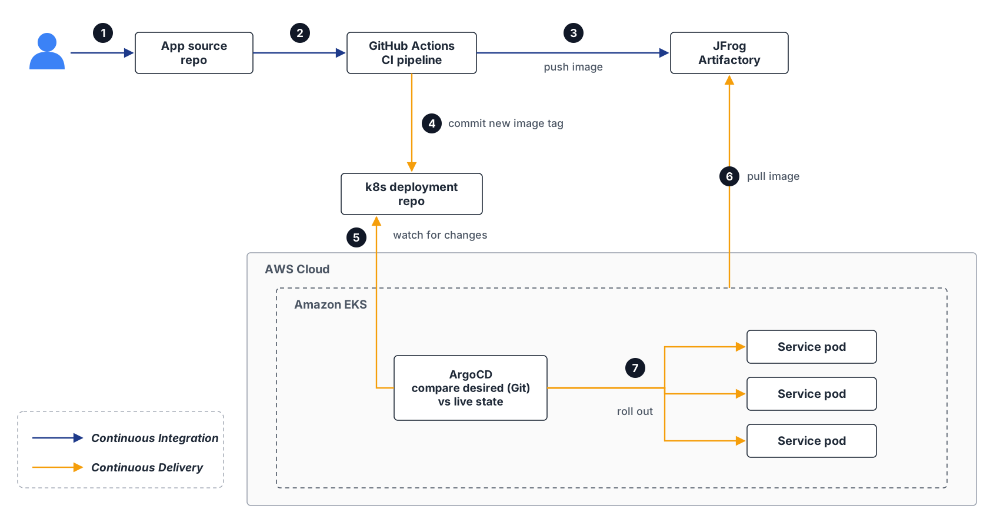
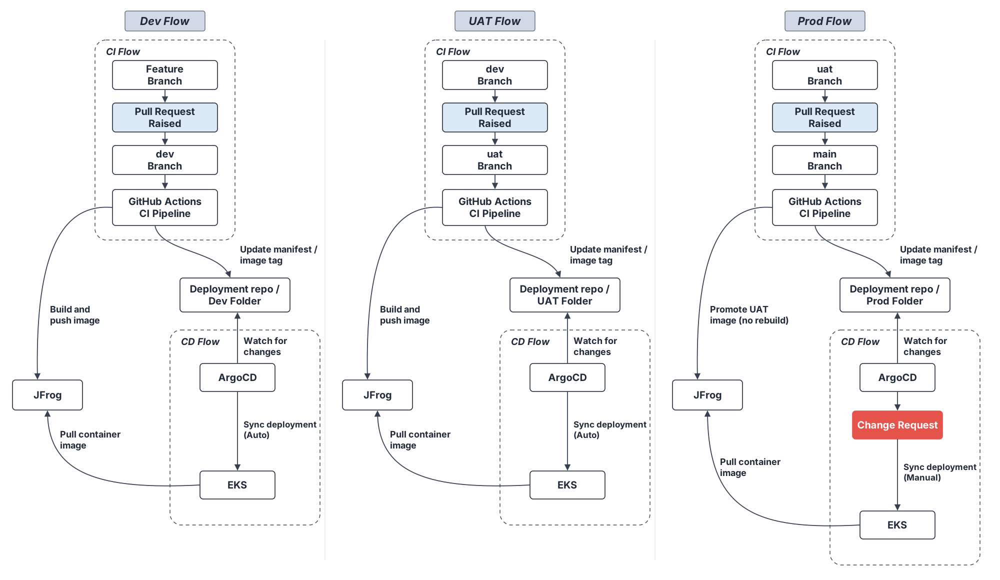
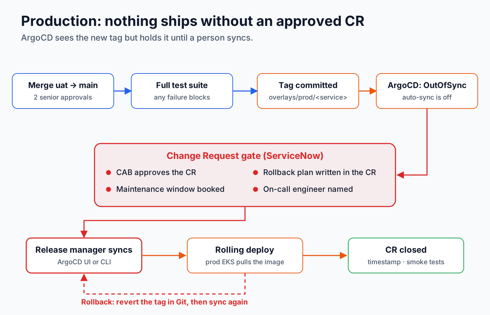
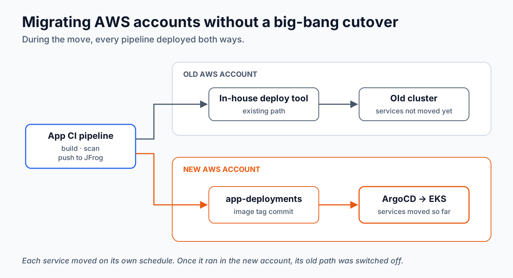

# GitOps From Zero

A working GitOps setup for many microservices across **dev, UAT and prod**: GitHub Actions builds the image, Kustomize describes each environment, and ArgoCD deploys whatever Git says.

It is the companion repo to my article series *GitOps From Zero*, based on a setup I designed for roughly 40 microservices on Amazon EKS. Clone it, point it at a cluster, and you have the same flow running in about ten minutes.



## What you get

- **One repo for every service's deployment config**, all under `platform-apps/`: a `base` per service and an overlay per environment.
- **ApplicationSets** that create an ArgoCD Application for each folder. Adding a service means adding a folder, with no ArgoCD YAML to write.
- **Auto sync for dev and UAT, manual sync for prod.** Prod changes show up as `OutOfSync` and wait for a person to approve them.
- **A tag-update script that survives parallel pipelines.** Forty services pushing to one repo at the same time do not lose updates.
- **Build once, promote everywhere.** Prod never rebuilds; it runs the exact image UAT tested.
- **CI that validates every overlay** on each pull request, so a broken manifest never reaches ArgoCD.

## How a change flows

```text
feature → develop → uat → main
            │        │      │
            ▼        ▼      ▼
           dev      uat    prod     (folders under platform-apps/overlays/)
          auto     auto   manual    (ArgoCD sync)
```

1. A developer merges into `develop` in an **app repo**.
2. That repo's CI builds and scans the image and pushes it to the registry.
3. CI runs `scripts/update-image-tag.sh`, which changes one line in `platform-apps/overlays/dev/<service>/kustomization.yaml` in **this** repo.
4. ArgoCD sees the commit and rolls out the new image.
5. Promotion to UAT works the same way. Promotion to prod copies the image UAT is running (same digest) and writes that tag to `platform-apps/overlays/prod/`. ArgoCD then waits for a manual sync.



The CI pipeline never talks to the cluster. It only writes to Git, so it never needs cluster credentials.

## Repo layout

```text
.
├── platform-apps/                 # everything ArgoCD deploys
│   ├── base/
│   │   └── sample-app/            # what every environment shares
│   ├── overlays/
│   │   ├── dev/sample-app/        # image tag, replicas, env-specific settings
│   │   ├── uat/sample-app/
│   │   └── prod/sample-app/       # + PodDisruptionBudget
│   └── apps/
│       ├── dev/applicationset.yaml    # auto sync
│       ├── uat/applicationset.yaml    # auto sync
│       └── prod/applicationset.yaml   # manual sync
├── scripts/
│   └── update-image-tag.sh    # rebase-and-retry tag update, used by app CI
├── examples/
│   └── app-repo/.github/workflows/ci.yml   # CI to copy into each app repo
├── .github/
│   ├── workflows/validate.yml # renders and validates every overlay on PRs
│   └── CODEOWNERS             # prod changes need the release owners
└── Makefile
```

## Quick start (local, about 10 minutes)

You need [kind](https://kind.sigs.k8s.io/), `kubectl` and a fork of this repo.

1. **Fork this repo**, then replace the repo URL in the three `platform-apps/apps/*/applicationset.yaml` files with your fork's URL.

2. **Create a cluster and install ArgoCD:**

   ```bash
   kind create cluster --name gitops
   kubectl create namespace argocd
   kubectl apply -n argocd --server-side --force-conflicts \
     -f https://raw.githubusercontent.com/argoproj/argo-cd/v3.5.5/manifests/install.yaml
   kubectl -n argocd rollout status deploy/argocd-server
   ```

3. **Create the three environments:**

   ```bash
   kubectl apply -f platform-apps/apps/dev/ -f platform-apps/apps/uat/ -f platform-apps/apps/prod/
   ```

4. **Open the ArgoCD UI:**

   ```bash
   kubectl -n argocd port-forward svc/argocd-server 8080:443
   # user: admin
   kubectl -n argocd get secret argocd-initial-admin-secret -o jsonpath='{.data.password}' | base64 -d; echo
   ```

   Open https://localhost:8080. `dev-sample-app` and `uat-sample-app` sync on their own. `prod-sample-app` stays `OutOfSync` until you press **Sync**: that is the prod gate.

5. **Try a deploy.** Change `newTag` in `platform-apps/overlays/dev/sample-app/kustomization.yaml`, commit and push to your fork. ArgoCD picks it up within about three minutes (or instantly with a webhook, see below).

> For the demo, all three environments run as namespaces in one cluster. In a real setup each environment has its own cluster and its own ArgoCD, which is how the original system works.

## Adding a service

```bash
cd platform-apps
cp -r base/sample-app base/payment
for env in dev uat prod; do cp -r overlays/$env/sample-app overlays/$env/payment; done
# rename sample-app -> payment inside the new folders, set the image, commit
```

The ApplicationSets find the new folders and create `dev-payment`, `uat-payment` and `prod-payment` on their own.

**Naming convention:** the image placeholder in `platform-apps/base/<service>/deployment.yaml` has the same name as the service folder. `update-image-tag.sh` relies on it.

## The tag-update script

`scripts/update-image-tag.sh <env> <service> <image> <tag>`

With dozens of pipelines pushing to one repo, two of them often finish at the same moment and one push is rejected. Without a retry, that deploy silently disappears. The script avoids this by starting every attempt from the latest remote state, re-applying the edit and pushing again, up to five times with jitter.

It was tested with six pipelines pushing at once, three of them editing the same file: every update landed.

Two builds of the *same* service can still finish out of order, so the example CI puts each service and branch in its own `concurrency` group. Deploys of one service run in commit order, while different services stay parallel.

## The prod gate



`platform-apps/apps/prod/applicationset.yaml` has no `automated` sync policy. In the original setup, a prod sync also required an approved Change Request (ServiceNow), a booked maintenance window and a named on-call engineer. Rollback is a Git revert of the tag, followed by a sync.

## Validate locally

```bash
make validate                          # render + validate every overlay and the ApplicationSets
make render ENV=prod APP=sample-app    # print what ArgoCD will apply
make diff APP=sample-app A=uat B=prod  # see exactly how two environments differ
```

Needs `kustomize` 5.x and `kubeconform`.

## Production checklist

This repo is a starting point. Before running it for real:

- [ ] Protect `main`: pull requests only, two approvals, CODEOWNERS required for `platform-apps/overlays/prod/`.
- [ ] Use a **GitHub App** (not a personal token) for the CI bot, scoped to this one repo.
- [ ] Add a **webhook** from this repo to ArgoCD so syncs start instantly instead of every ~3 minutes.
- [ ] Make image tags **immutable** in your registry, or pin by digest.
- [ ] Handle **secrets** with External Secrets Operator, Sealed Secrets or your cloud's secret manager, never in this repo.
- [ ] Give each environment its own ArgoCD **AppProject** with only the namespaces and clusters it needs.

## Migrating from an existing deploy tool

You don't need a big-bang cutover. Keep your current pipeline, add the tag-update step at the end, and let both deploy paths run side by side. Move services one at a time and switch the old path off once each one is healthy under ArgoCD.



## License

MIT. Use it, change it, ship it.

*Diagrams were drawn with AI assistance.*
